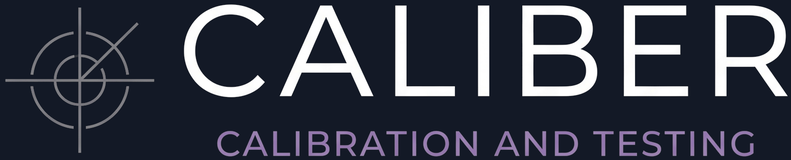
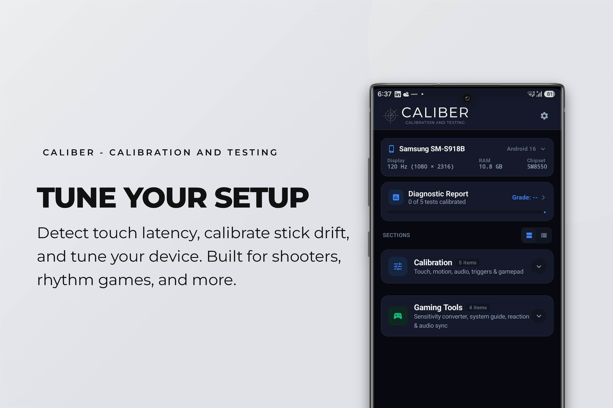
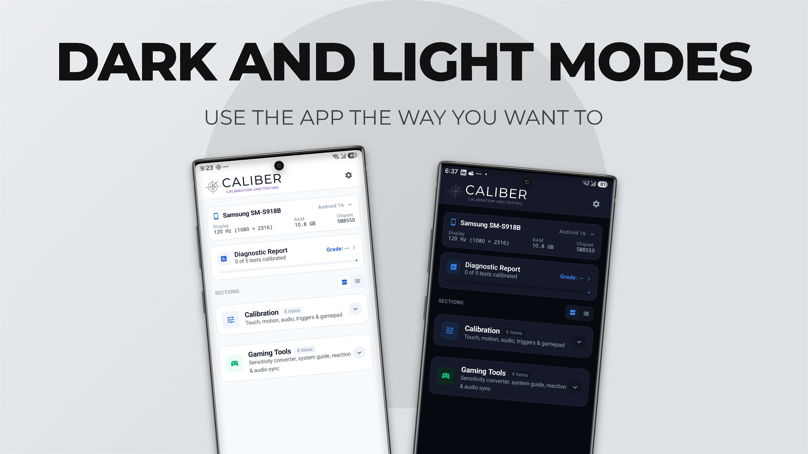
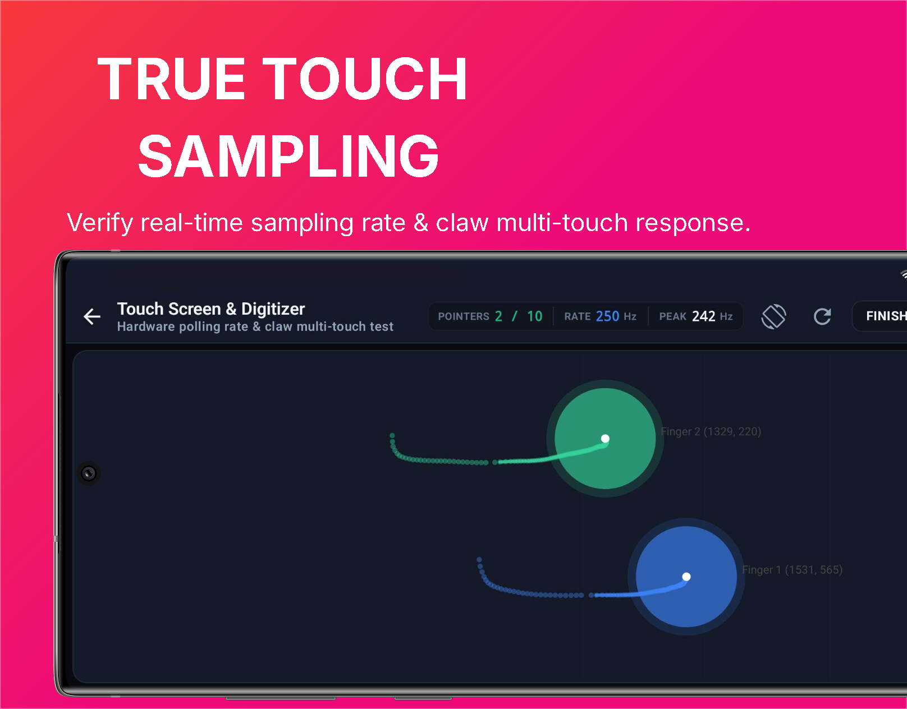
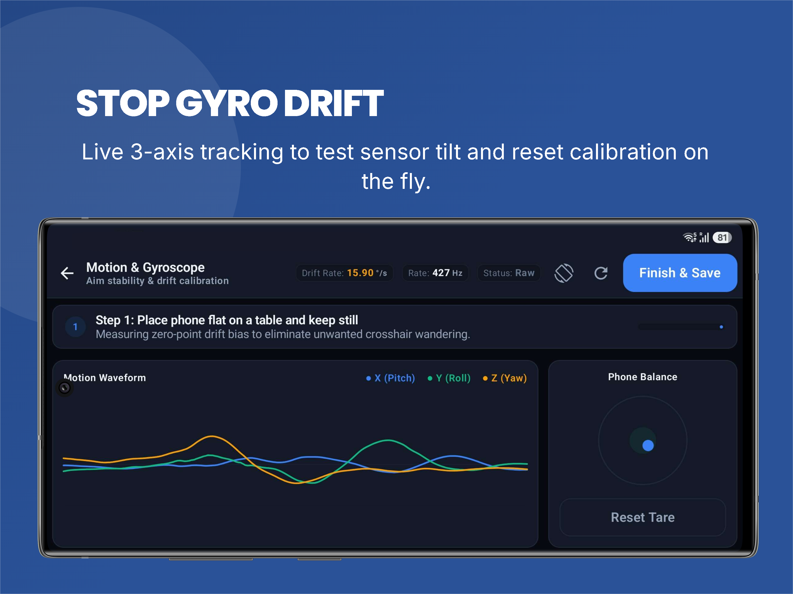
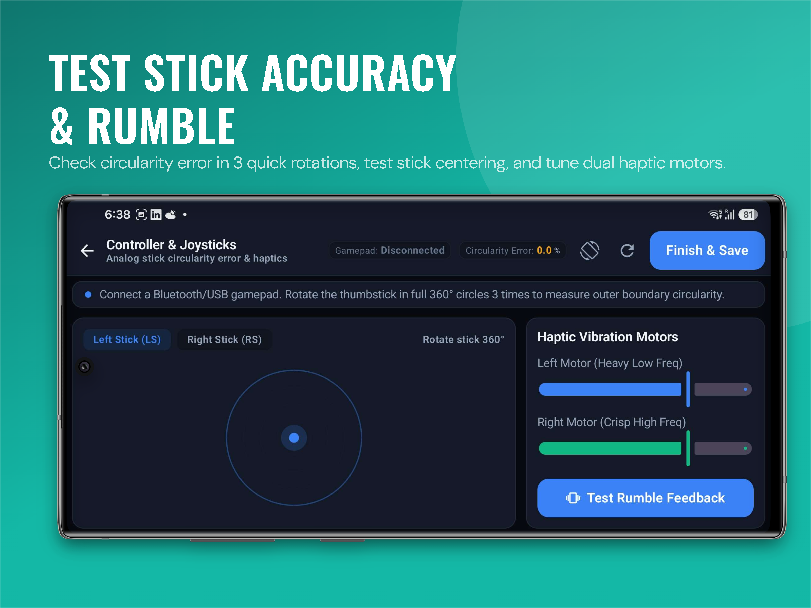
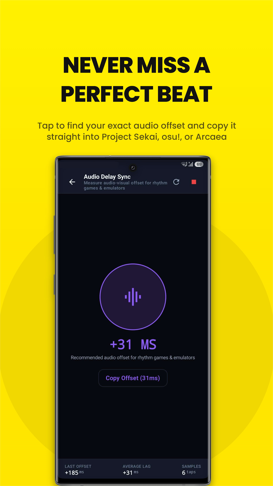
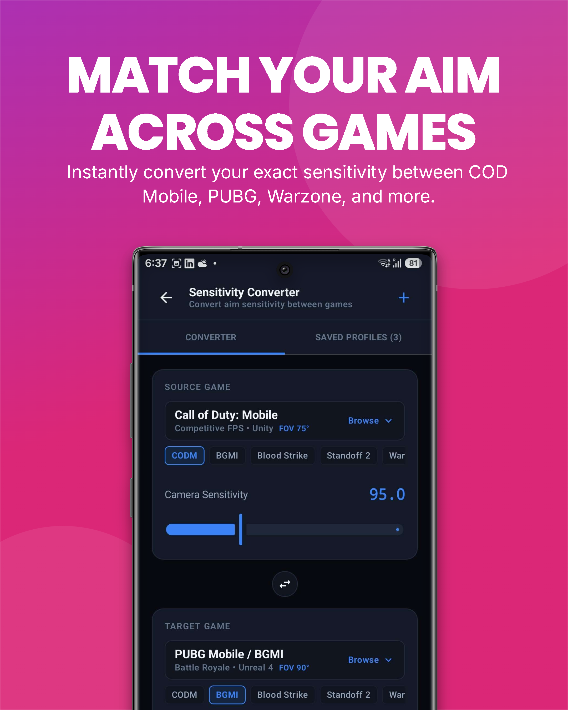
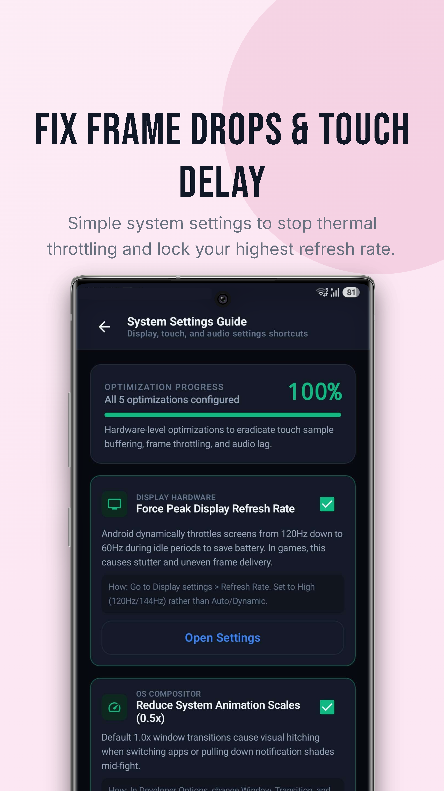
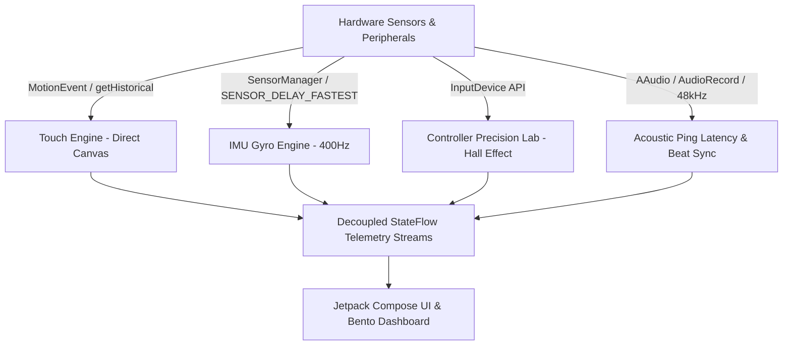

<div align="center">

  

  <h3>The Native Android Hardware Diagnostics & Esports Calibration Suite</h3>

  <p>
    <strong>Engineered for competitive mobile gamers, esports athletes, and hardware reviewers.</strong><br/>
    Benchmarking true digitizer touch polling rates, eliminating gyro drift, diagnosing gamepad stick circularity, and syncing sub-frame audio latency.
  </p>

  <p>
    <a href="https://github.com/MavihsLH/caliber-mobile-testing-suite/releases"></a>
    <a href="https://kotlinlang.org"></a>
    <a href="https://developer.android.com/jetpack/compose"></a>
    <a href="#-privacy-first-architecture"></a>
    <a href="LICENSE"></a>
  </p>

  <br/>

  

</div>

---

## ⚡ Overview

**Caliber** is an open-source, bare-metal hardware diagnostics and calibration suite built from the ground up in modern **Kotlin** and **Jetpack Compose**. Unlike generic test apps that are bottlenecked by standard 60Hz/120Hz UI draw cycles, Caliber bypasses Android compositor constraints with high-frequency event capture pipelines, sample-accurate acoustic loopback, and zero-allocation hardware telemetry.

Whether you are tuning claw-grip sensitivity for *PUBG Mobile* / *Warzone Mobile*, verifying a smartphone's advertised 720Hz touch sampling claim, testing for Hall Effect joystick circularity, or calibrating millisecond audio offset for rhythm games, Caliber provides laboratory-grade telemetry right on your device.

---

## 🎨 Dual Theme Design System

Caliber features an adaptive, gamer-centric interface designed specifically for competitive landscape play.

<p align="center">
  
</p>

* **OLED Cyber Dark Mode:** Pure Pitch Black (`#000000`) canvas with high-contrast Cyber Cyan (`#38BDF8`), Matrix Green (`#00FF9D`), Warning Amber (`#FF9500`), and Crimson (`#FF2A55`) accents. Maximizes OLED battery conservation and minimizes ambient glare during tournaments.
* **Crisp Daylight Mode:** Clean, slate-tinted daylight interface engineered for outdoor sunlight legibility and hardware review photography.
* **State-Preserving Bento Dashboard:** Segmented accordion layout that remembers your exact workspace preferences and open categories across deep navigation.

---

## 🕹️ Deep-Dive Hardware Modules

### 1. Touchscreen & Digitizer Lab (Direct API)

Verify true digitizer hardware capabilities beyond standard OS display refresh limitations.

<p align="center">
  
</p>

* **Sub-Frame Historical Coordinate Interrogation:** Captures uncoalesced sub-frame micro-packets via `MotionEvent.getHistoricalX()`, `getHistoricalY()`, and `getHistoricalEventTime()`. Accurately isolates true digitizer polling (240Hz, 360Hz, 480Hz, 720Hz+) from display VSYNC.
* **10-Point Claw Grip Matrix:** Tracks simultaneous multi-finger inputs for 4-finger to 6-finger competitive layouts with contact discs scaled dynamically by `MotionEvent.getPressure()` and `MotionEvent.getSize()`.
* **Packet Jitter & Interval Variance ($\sigma$):** Real-time standard deviation calculation of packet arrival intervals in milliseconds to detect touch polling instability and micro-stutters.
* **Zero-Allocation Canvas Engine:** Direct `DrawScope` vector rendering decoupled from Compose recomposition churn.

---

### 2. Motion Sensor Lab (6-Axis IMU & Zero-Point Drift)

Eliminate gyro drift and tune tilt-aiming responsiveness for mobile FPS and racing titles.

<p align="center">
  
</p>

* **High-Speed Sensor Hook:** Direct interface to `SensorManager` with `SENSOR_DELAY_FASTEST` for `Sensor.TYPE_GYROSCOPE` and `Sensor.TYPE_ACCELEROMETER` (>200Hz–400Hz+ sampling rate).
* **Zero-Point Drift Calibration:** Computes resting angular velocity bias $(\mu_x, \mu_y, \mu_z)$, drift magnitude $\|\vec{\omega}\|$ in $^{\circ}/\text{s}$ and $\text{rad}/\text{s}$, and sensor noise variance $\sigma^2$.
* **3-Channel Rolling Oscilloscope:** Live continuous waveform tracking of Gyro X (Cyan), Y (Green), and Z (Amber) axes.
* **One-Tap Tare Bias Subtraction:** Instantly zeroes out sensor tilt bias on the fly to prevent crosshair drift during critical engagements.

---

### 3. Controller Precision Lab (Hall Effect & Joysticks)

Benchmark gamepad analog stick precision, verify Hall Effect electromagnetic sensors, and test haptic motors.

<p align="center">
  
</p>

* **360° Circularity Error Benchmark:** Maps stick sweeps across 360 angular sectors ($1^\circ$ bins) and calculates outer boundary circularity error:
  $$\text{Circularity Error \%} = \frac{1}{N} \sum_{i=1}^{N} |r_i - 1.0| \times 100\%$$
* **Hall Effect vs. Potentiometer Verification:** Instantly exposes squared outer clipping (typical of degraded potentiometers, error $>15\%$) versus smooth true circular gating (Hall Effect / TMR electromagnetic sensors, error $<5\%$).
* **Centering & Deadzone Analysis:** Identifies mechanical stick drift at rest and premature boundary saturation.
* **Dual Rumble Motor Testing:** Independently triggers low-frequency and high-frequency vibration motors with real-time duty cycle sliders.

---

### 4. Audio Delay Sync & Latency Suite

Measure and calibrate millisecond audio-visual latency for rhythm games, FPS titles, and emulators.

<p align="center">
  
</p>

* **Interactive Tap-to-the-Beat Calibrator:** Rhythm game audio offset calibrator designed for *Project Sekai*, *Arcaea*, *Cytus II*, *Phigros*, and *Lanota*. Computes mean tap timing offset ($\Delta t$) and jitter standard deviation with instant in-app auditioning.
* **Bare-Metal Acoustic Matched-Filter Ping:** Synthesizes a 15ms Hann-windowed 2.4 kHz transient audio chirp via `AudioTrack` and captures physical sound arrival through `AudioRecord` at 48,000 Hz.
* **Cross-Correlation Detection ($R_{xy}$):**
  $$R_{xy}[k] = \sum_n x[n] y[n+k]$$
  Calculates sample-accurate round-trip transit delay, distinguishing low-latency 3.5mm/Type-C DACs ($<25\text{ms}$) and gaming codecs ($40–70\text{ms}$) from standard Bluetooth SBC/AAC ($120–220\text{ms}$).

---

### 5. Universal Sensitivity Converter

Translate aim muscle memory seamlessly across competitive mobile shooter engines.

<p align="center">
  
</p>

* **Cross-Engine Aim Translation:** Mathematically maps standard camera, ADS, and scoped sensitivities across major competitive mobile shooters:
  * *PUBG Mobile / BGMI*
  * *Call of Duty: Mobile (CODM)*
  * *Call of Duty: Warzone Mobile*
  * *Apex Legends Mobile*
  * *Free Fire / Free Fire MAX*
  * *Arena Breakout*
  * *Rainbow Six Mobile*
  * *Blood Strike*
  * *T3 Arena*
  * *Critical Ops*
  * *Standoff 2*
  * *Special Forces Group 2 / Combat Master*
* **Full Optical Reticle Support:** Scales sensitivity across 1x Red Dot / Holographic, 2x, 3x, 4x, 6x, and 8x Sniper scopes with FoV compensation.

---

### 6. System Settings & Gaming Optimization Guide

Unlock maximum performance from your device with an interactive hardware optimization checklist.

<p align="center">
  
</p>

* **Step-by-Step Optimization Routines:**
  * Forcing maximum display refresh rate (90Hz / 120Hz / 144Hz / 165Hz)
  * Enabling OEM Game Turbo / Game Space touch sampling boost
  * Disabling palm and edge mis-touch deadzones
  * Removing aggressive OS thermal throttling & battery saver limits
  * Configuring low-latency Bluetooth audio codecs (LDAC, aptX Adaptive, LHDC)
* **Direct System Shortcuts:** One-tap navigation to deep Android settings submenus (Developer Options, Display Settings, Battery Optimization).

---

## 🎯 Additional Esports Testing Tools

| Module | Purpose | Metrics Captured |
| :--- | :--- | :--- |
| **Physical Triggers & Floating HUD** | Test capacitive shoulder buttons & display in-game telemetry HUD. | Actuation latency (ms), Hold duration, Clicks-per-second (CPS), Live In-Game Overlay FPS & Touch Hz. |
| **Target Acquisition Drill** | Benchmark reaction and micro-flick target acquisition accuracy. | Time to First Hit (TTF in ms), Miss Rate %, Target Dispersion radius, Esports Tier (S+ to C). |
| **Visual Reaction Benchmark** | Measure pure neuromuscular visual stimulus response. | Best latency, Mean latency, 95th percentile, False-start penalty protection. |

---

## 🔒 Privacy-First Architecture

* **100% Offline & Local:** Caliber executes entirely on-device. No telemetry, no analytics beacons, and no tracking libraries.
* **No Account Required:** No logins, subscriptions, or dark patterns.
* **Transparent Permissions:** Only requests hardware permissions essential for testing (e.g., `RECORD_AUDIO` strictly for acoustic loopback ping; `SYSTEM_ALERT_WINDOW` strictly for optional floating HUD).

---

## 🛠️ Architecture & Tech Stack



* **Language:** Kotlin 2.0.21
* **UI Framework:** Jetpack Compose (BOM 2024.10.00) with Material 3 Dynamic Theming
* **Graphics:** Direct vector operations via `DrawScope`, zero-allocation rendering with `withFrameNanos`
* **Sensor Pipeline:** `SensorManager` event listeners executing on background coroutine dispatchers
* **Audio Pipeline:** `AudioTrack` & `AudioRecord` with `PERFORMANCE_MODE_LOW_LATENCY`

---

## 🚀 Building from Source

### Prerequisites
* **Android Studio:** Ladybug (2024.2.1) or newer
* **Android SDK:** API Level 35 / 36
* **JDK:** Version 21 (bundled with Android Studio JBR)
* **Gradle:** 8.14.3

### Build Commands

```powershell
# Clone the repository
git clone https://github.com/MavihsLH/caliber-mobile-testing-suite.git
cd "caliber-mobile-testing-suite"

# Build debug APK
.\gradlew assembleDebug

# Install on connected device via ADB
.\gradlew installDebug
```

---

## 📄 License

Caliber is licensed under the **Apache License, Version 2.0**. See the [LICENSE](LICENSE) file for full details.
